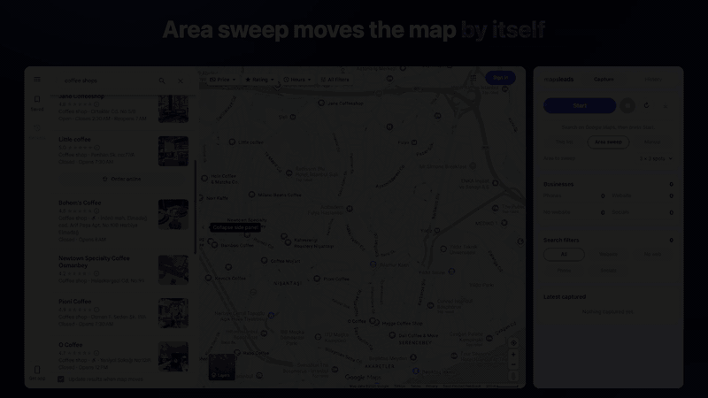

<p align="center">
  
</p>

<h1 align="center">Maps Lead Scraper</h1>

<p align="center">
  Turn any Google Maps search into a clean lead list. Open-source Chrome extension (Manifest V3).
</p>

<p align="center">
  
</p>

## Features

- **Area sweep**: the map moves by itself in a spiral (3×3, 5×5 or 7×7 spots) and the results list is emptied at every spot. In the demo above, a 3×3 sweep collected 282 coffee shops in under 3 minutes.
- **This list**: scrolls the current results list to its end, then stops.
- **Manual**: only records what you browse.
- Live counts for phones, websites, businesses without a website and social profiles.
- Filters (All, Website, No web, Phone, Socials) and one-click **CSV export**.
- History of capture sessions; continue a session later or export it again.
- **Stays on Google Maps**: no other sites, no server, no account. Data stays in your browser.

## Install

- **Chrome Web Store**: coming soon.
- **From source**: clone this repo, open `chrome://extensions`, enable **Developer mode**, click **Load unpacked** and pick the `extension/` folder.

## Use

1. Search on Google Maps, for example `coffee shops` or `diş hekimi ankara`.
2. Click the extension icon to open the side panel, pick a mode and press **Start**.
3. Keep the Maps tab in front while a sweep runs (Chrome slows down timers in background tabs).
4. Filter and export with the ⤓ button.

## Captured fields

Name, category, all categories, phone, international phone, website, social profile (when the business lists Facebook, Instagram etc. as its website on Maps), rating, review count, address (street, neighbourhood, city, postal code, state, country), coordinates, opening hours, place ID, CID, Google Maps URL and capture time.

Emails are not collected: Google Maps does not publish them and the extension never visits business websites. Review counts are missing when Google shows its signed-out "limited view"; sign in to Google for complete data.

## How it works

1. `extension/src/content/inject.js` runs in the Maps page (MAIN world) and taps the responses of `/search?tbm=map` (search results and pagination) and `/maps/preview/place`. Maps streams these XHRs and calls `abort()` from its own `progress` handler as soon as they finish, so the body is read on `readyState 4` and inside a wrapped `abort()`; `load` never fires.
2. `extension/src/content/bridge.js` forwards bodies to the service worker and drives the page:
   - ticks Maps' "Update results when map moves" so every map move runs a new search;
   - scrolls the results list until the end marker (`span.HlvSq`) appears, or ~15 s pass without new cards;
   - in Area sweep, drags the map with synthetic mouse events on the canvas, spread over ~0.5 s and held still before release. A burst of events reads as a fling and overshoots several times.
3. `extension/src/background.js` parses responses (`extension/src/lib/parser.js`), dedupes by place ID per session and stores rows in IndexedDB (`extension/src/lib/db.js`).
4. `extension/src/sidepanel/` renders the panel; `extension/src/lib/export.js` builds the CSV.

## Development

```sh
npm install          # playwright-core, only for the asset scripts
npm test             # parser and CSV tests against a real Maps response in test/fixtures
npm run package      # dist/maps-lead-scraper-<version>.zip for the Chrome Web Store
```

Asset scripts need a [Chrome for Testing](https://googlechromelabs.github.io/chrome-for-testing/) binary in `CHROME_PATH` (branded Chrome no longer loads unpacked extensions from the command line):

```sh
CHROME_PATH=/path/to/chrome node scripts/render-icons.mjs     # extension/icons/*.png from icon.svg
CHROME_PATH=/path/to/chrome node scripts/promo/record.mjs     # live area sweep → store/build/raw
CHROME_PATH=/path/to/chrome node scripts/promo/compose.mjs    # store screenshots, promo tiles, promo.mp4
```

Store listing texts and permission justifications are in [`store/listing.md`](store/listing.md).

## Privacy

See [PRIVACY.md](PRIVACY.md). In short: no server, no analytics, nothing leaves your browser unless you export it.

## Disclaimer

This project is not affiliated with, endorsed by or sponsored by Google. Google Maps is a trademark of Google LLC. Automated collection may conflict with the Google Maps Terms of Service. You are responsible for how you use this tool and the data you export, including data protection and marketing laws such as GDPR or KVKK.

## License

[MIT](LICENSE)
